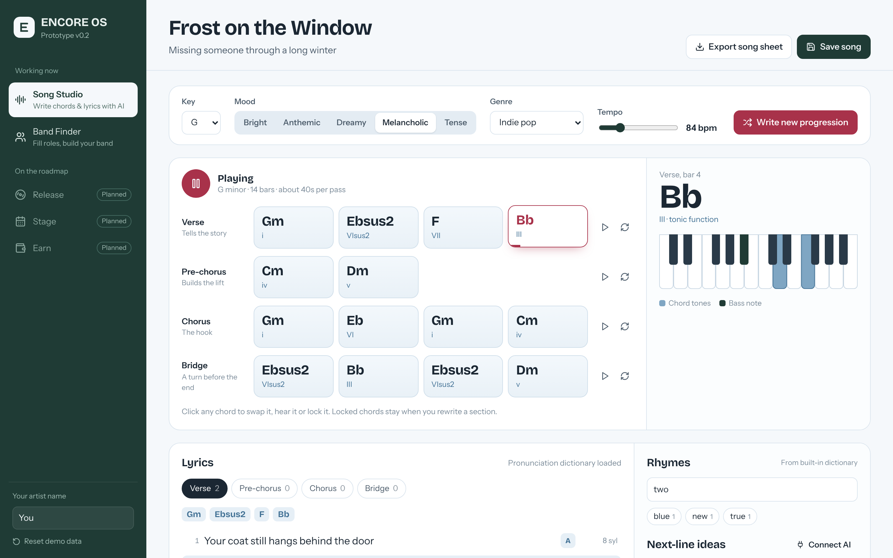
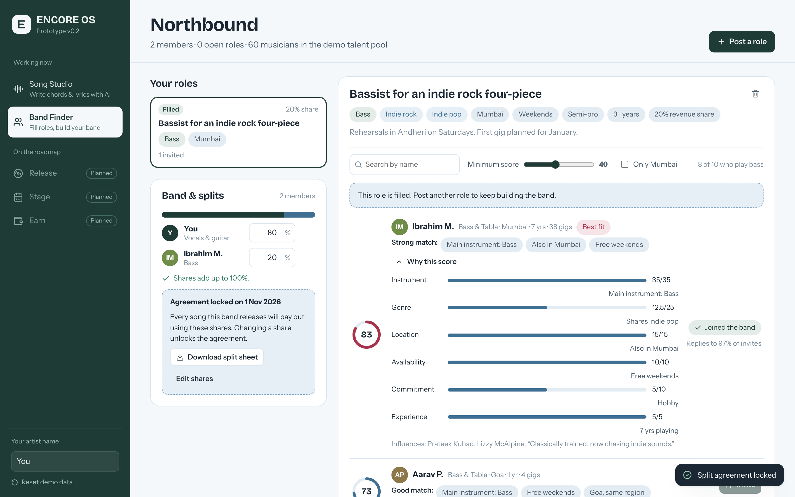

# ENCORE OS: prototype

**ENCORE OS** is our pitched business: an AI-powered operating system for independent musicians, where an artist can write, find bandmates, release, play live and get paid in one place.

This repository is the **first working prototype**. It implements **two core features** end to end. The other modules (Release, Stage and Earn) appear in the app as *Planned* and are not built yet.

**Live demo:** https://shrika-rana.github.io/encore-os/

| | Feature | What works today |
|---|---|---|
| 1 | **AI Song Studio** | Writes a full chord progression (verse, pre-chorus, chorus, bridge) from key, mood, genre and tempo. Plays it back in the browser with a synth band. Lets you swap, lock and rewrite chords. A lyric co-writer counts syllables, detects your rhyme scheme, finds rhymes and suggests next lines. |
| 2 | **Band Finder** | Post an open role (instrument, genres, city, schedule, commitment, revenue share). Musicians are ranked with an explainable 100-point match score. Invite them; when someone accepts they join the band. Keep a split agreement that always totals 100%, then lock it and download a split sheet. |



---

## Feature 1: AI Song Studio

- **Chord engine** (`src/lib/music/generator.ts`). Builds each progression from three things:
  - A Markov chain over scale degrees, with transition probabilities for major and minor keys.
  - A bias for each of five moods.
  - Well-known pop progressions as templates.
  
  Verses start on the tonic, chords never repeat back to back, and pre-choruses and bridges lean into the dominant. Genre sets each chord's colour: lo-fi and R&B use 7ths and 9ths, indie pop uses add9 and sus2, and so on. A given seed always reproduces the same song.
- **Playback** (`src/lib/music/audio.ts`). Runs on the Web Audio API, with no samples and no server. It plays a pad, bass, arpeggio and kick through a generated reverb. A look-ahead scheduler keeps timing tight, a playhead moves across the chords, and the keyboard lights up the voicing being played.
- **Chord swaps.** Click any chord to see alternatives, grouped as: same harmonic function, extensions, borrowed chords, and every chord in the key. You can audition a chord, replace it, or lock it so it survives a rewrite.
- **Lyric tools** (`src/lib/lyrics/`). These run on the CMU Pronouncing Dictionary (134,000 words):
  - syllable counts for each line, which turn amber when a line won't fit the melody;
  - automatic rhyme-scheme letters (A, B, C…);
  - perfect and near rhymes for any word.
  
  Rhymes come from the free Datamuse API when the app is online, with an offline fallback.
- **Next-line co-writer.** The default offline engine combines your theme, real rhymes and a syllable target. Paste a Google Gemini key, or a key for any OpenAI-compatible API, and a large language model writes original lines using the song's title, theme, chords and previous lines. The key is stored only in your browser.
- Songs are saved to a library, and you can export a plain-text song sheet.

## Feature 2: Band Finder

- **Talent pool.** 60 fictional musician profiles across 10 Indian cities, generated deterministically in `src/lib/band/data.ts`. The pool deliberately has more guitarists than bassists, to mirror real scenes.
- **Explainable matching** (`src/lib/band/matching.ts`). Each musician gets a score out of 100 from six factors:

  | Factor | Max points |
  |---|---|
  | Instrument | 35 |
  | Genre overlap | 25 |
  | Location (city, region or remote) | 15 |
  | Schedule overlap | 10 |
  | Commitment level | 10 |
  | Experience | 5 |

  The "Why this score" button shows how each factor contributed.
- **Invitations.** In the prototype, demo musicians reply on their own after a few seconds. Stronger matches are more likely to accept, and the result is seeded so a demo can be repeated exactly.
- **Split agreements** (`src/lib/band/splits.ts`). When someone accepts, they join with the share the role offered, and everyone else's share scales down to make room. Shares must total 100% before you can lock the agreement and download a split sheet.



---

## Run it locally

```bash
npm install
npm run dev        # http://localhost:5173/encore-os/
npm test           # 32 unit tests
npm run build      # production build in dist/
```

The end-to-end browser check, which drives both features in Chromium, is in `scripts/e2e.cjs`. The file explains how to run it. `npx vite-node scripts/benchmark.ts` prints speed and accuracy figures.

## Test results (prototype v0.2)

- **Unit tests:** 32 of 32 pass (`npm test`). They cover music theory, the generator (1,000 generated songs checked for staying in key), pronunciation and rhyme, matching, and splits.
- **End-to-end:** 11 of 11 checks pass in headless Chromium (`scripts/e2e.cjs`).
- **Speed:**
  - generating a full song takes about 0.02 ms;
  - ranking 60 musicians for one role takes about 0.03 ms.
- **Rhyme detection:** 24 of 25 hand-labelled word pairs correct. The one miss, "rain/again", happens because the dictionary uses the American pronunciation of "again".

## Implemented, simulated and planned

| Implemented | Simulated in this prototype | Planned |
|---|---|---|
| Chord generation, playback, swaps and locks; syllables, rhyme scheme and rhyme search; offline and AI line suggestions; saving and exporting songs; role posting, ranking and explanations; split agreements and split sheets | The musician profiles are fictional. Invitation replies are automatic. All data stays in the browser (localStorage), with no accounts or backend. | Release (distribution), Stage (live-show marketplace), Earn (payout wallet), real user accounts, real-time messaging |

## Tech

React 18, TypeScript, Vite, Zustand, the Web Audio API, the CMU Pronouncing Dictionary, the Datamuse API and Vitest. The design uses a Nordic winter palette (snow, frost, glacier, spruce, lingonberry) and two typefaces: Bricolage Grotesque and Instrument Sans.

```
src/
  lib/music/     theory.ts · generator.ts · audio.ts
  lib/lyrics/    pron.ts · rhymes.ts · cowriter.ts · wordbank.ts
  lib/band/      data.ts · matching.ts · splits.ts · responses.ts
  features/      studio/ (Song Studio UI) · band/ (Band Finder UI)
tests/           music · lyrics · band unit tests
```

MIT licence.
